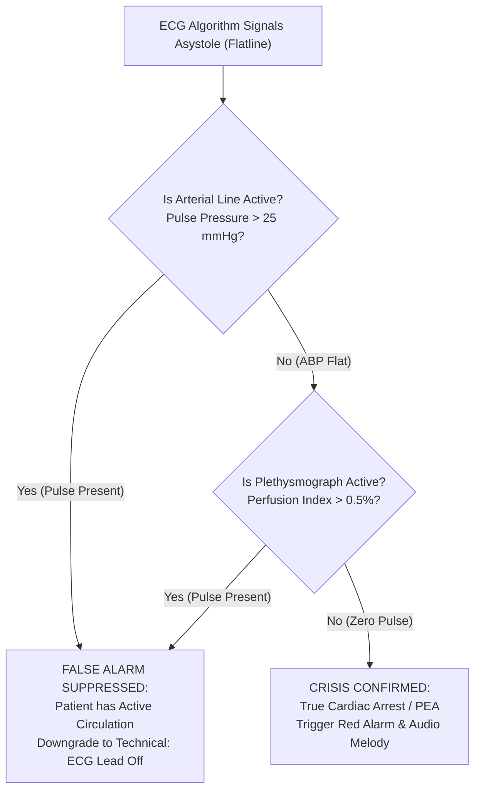

# IEC 60601-1-8 Medical Alarm System and Multi-Sensor Fusion

This document details the architecture, priority tiers, latching state machine, and multi-sensor Bayesian confidence fusion algorithms governing patient alarms in Systole, in strict compliance with the IEC 60601-1-8 international medical electrical equipment standard.

---

## 1. Alarm Priority Tiers and Presentation Requirements

IEC 60601-1-8 defines distinct categories based on the urgency of required clinical response:

```
+----------------------------------------------------------------------------------+
| CRISIS (HIGH PRIORITY)                                                           |
| Potential Death or Irreversible Injury within Minutes if Unattended              |
| Color: Flashing High-Visibility Red (#FF0033)                                    |
| Acoustic Melody: High-urgency 10-pulse chime burst (repeating every 5 seconds)    |
| Conditions: Asystole, Ventricular Fibrillation, Extreme Bradycardia (<40 bpm),  |
|             Critical Desaturation (SpO2 < 80%), Severe Hypotension (MAP < 50)    |
+----------------------------------------------------------------------------------+
                                        |
                                        v
+----------------------------------------------------------------------------------+
| WARNING (MEDIUM PRIORITY)                                                        |
| Prompt Clinical Action Required to Prevent Impairment                            |
| Color: Flashing Amber Yellow (#FFCC00)                                           |
| Acoustic Melody: Moderate-urgency 3-pulse chime burst (repeating every 20 s)     |
| Conditions: Sustained Ventricular Tachycardia, ST Elevation (>0.2 mV),            |
|             Moderate Hypoxemia (SpO2 80-89%), Tachycardia (>130 bpm)             |
+----------------------------------------------------------------------------------+
                                        |
                                        v
+----------------------------------------------------------------------------------+
| ADVISORY (LOW PRIORITY)                                                          |
| Operator Awareness Required; No Acute Physiological Threat                       |
| Color: Constant Non-Flashing Cyan / Amber (#00E5FF)                              |
| Acoustic Melody: Single low-urgency informational tone                           |
| Conditions: Minor parameter drift, Battery low, Early warning score elevations   |
+----------------------------------------------------------------------------------+
                                        |
                                        v
+----------------------------------------------------------------------------------+
| TECHNICAL FAILURE (EQUIPMENT ALERT)                                              |
| Inability of Telemetry System to Monitor Patient Safely                          |
| Color: Non-Flashing Blue/Cyan with Lead Identifier                               |
| Acoustic Melody: Distinct two-tone equipment warning                             |
| Conditions: ECG Lead Off, ABP Transducer Disconnected, PPG Optical Decoupling    |
+----------------------------------------------------------------------------------+
```

---

## 2. Multi-Sensor Bayesian Confidence Fusion

In real-world intensive care units, up to 88% of acoustic alarms are clinically false or artifactual, primarily caused by patient movement, electrode peeling, or electrocautery noise. Alarm fatigue significantly desensitizes clinical staff, creating grave patient safety hazards.

Systole implements cross-channel physiological consistency arbitration to verify alarm validity before sound emission.

### Cross-Modal Consistency Rules



1. **True Asystole vs ECG Lead Disconnect**:
   * If ECG indicates flatline Asystole, the fusion engine cross-checks invasive arterial pressure pulsatility ($PP = SBP - DBP$) and photoplethysmographic perfusion index ($PI$).
   * If arterial pulsatility exceeds $25 \text{ mmHg}$ or plethysmographic perfusion index exceeds $0.5\%$, the circulatory system is confirmed active (patient is alive and perfused). The alarm is converted from a physiological Crisis (Asystole) to an equipment Technical alert (`EcgLeadOff`), preventing unnecessary resuscitation code alerts.
2. **Ventricular Tachycardia Motion Artifact Suppression**:
   * If ECG indicates polymorphic V-Tach ($HR > 140$ bpm) but the invasive arterial pulse rate remains normal ($75$ bpm) and ECG signal quality index ($SQI < 0.40$), the event is classified as motion artifact and silenced.
3. **Optical Sensor Displacement vs Severe Hypoxemia**:
   * If $SpO_2$ abruptly drops below $80\%$ but perfusion index plummets to near zero ($PI < 0.05\%$) while capnography and respiratory mechanics remain normal, the event is classified as `PpgProbeOffFinger` rather than acute respiratory arrest.

---

## 3. Alarm State Machine and Latching Rules

### Latching vs Non-Latching Alarms

* **Latching Alarms**: Crisis events (Asystole, V-Fib) remain in the active alarm banner even if the physiological condition transiently normalizes, ensuring the attending intensivist is notified of the life-threatening event until manually acknowledged.
* **Non-Latching Alarms**: Moderate advisory conditions automatically resolve and clear once the physiological parameter returns within normal clinical boundaries for at least 5 consecutive seconds.

### 120-Second Audio Silence Timer

Compliant with IEC 60601-1-8 Section 6.8:
* When the operator activates `Silence Alarms [ESC]`, all acoustic annunciators are muted for a strict 120-second countdown period.
* The visual alarm banner remains active with an animated countdown clock (`MUTE 1:59`).
* Safety Override: If a new, higher-priority physiological crisis occurs during an active silence epoch (e.g. onset of Ventricular Fibrillation during a silenced advisory), the silence timer is immediately overridden and emergency acoustic chimes resume.

---

## 4. National Early Warning Score 2 (NEWS2) Integration

Systole continuously computes the clinical NEWS2 score to detect subtle multi-parameter deterioration before overt hemodynamic collapse:

| Physiological Parameter | 3 Points | 2 Points | 1 Point | 0 Points (Normal) | 1 Point | 2 Points | 3 Points |
| :--- | :--- | :--- | :--- | :--- | :--- | :--- | :--- |
| **Respiration Rate (bpm)** | $\le 8$ | | 9 to 11 | 12 to 20 | | 21 to 24 | $\ge 25$ |
| **SpO2 Scale 1 (%)** | $\le 91$ | 92 to 93 | 94 to 95 | $\ge 96$ | | | |
| **Systolic BP (mmHg)** | $\le 90$ | 91 to 100 | 101 to 110 | 111 to 219 | | | $\ge 220$ |
| **Pulse (bpm)** | $\le 40$ | | 41 to 50 | 51 to 90 | 91 to 110 | 111 to 130 | $\ge 131$ |
| **Temperature (C)** | $\le 35.0$ | | 35.1 to 36.0 | 36.1 to 38.0 | 38.1 to 39.0 | $\ge 39.1$ | |

Clinical Escalation Tiers:
* 0 to 4 Points: Low clinical risk (routine ward surveillance)
* 5 to 6 Points: Medium clinical risk (urgent bedside clinical assessment by medical emergency team)
* 7 or More Points: High clinical risk (immediate emergency transfer to ICU / critical care resuscitation)
