# Systole Architecture and Engineering Design

## System Overview

Systole is a deterministic, life-critical ICU physiological telemetry, multimodal hemodynamic monitoring, and clinical decision support workstation implemented in pure Elm. It adheres to the fault isolation and architectural safety principles required by IEC 62304 Class C medical device software.

The architecture eliminates entire categories of clinical computing failures at compile time:
* No runtime exceptions (NullPointerExceptions, undefined behavior, or memory corruption)
* Deterministic 200 Hz discrete-time signal processing execution with zero dynamic heap thrashing
* Strict mathematical decoupling between numerical signal conditioning and SVG graphics rendering
* IEC 60601-1-8 compliant multisensory alarm state machine with Bayesian false alarm mitigation

```mermaid
flowchart TD
    subgraph DataAcquisition [Physiological Telemetry Ingestion]
        AnalogSignals["Continuous Multi-Lead Telemetry\nECG I-III, aVR-aVF, V1-V6, ABP, PPG, Capno, CVP"]
        InboundBridge["WebSocket Gateway\nIEEE 11073-20601 DIM APDUs"]
    end

    subgraph DspEngine [Pure Elm Discrete-Time DSP Engine: 200 Hz]
        DF2T["Direct Form II Transposed Biquads\nButterworth Lowpass, Highpass, Notch"]
        PanTompkins["Pan-Tompkins QRS Classifier\nDual Adaptive Energy Thresholds"]
        PulseContour["Liljestrand-Zander Pulse Contour\nStroke Volume & PPV/SVV Fluid Responsiveness"]
        Oximetry["Beer-Lambert Extinction\nAC/DC Dual Wavelength SpO2 & PVI"]
        CapnoAnalysis["Microstream Capnography\nPhase I-IV Segmentation & VD/VT Dead Space"]
        VentEngine["Pulmonary Mechanics Integrator\nEquation of Motion Paw(t) = PEEP + Raw*Vdot + V/Cstat"]
        PvLoop["Suga-Sagawa Elastance Engine\nESPVR, EDPVR, Ea, and Ventriculo-Arterial Coupling"]
        DwtEngine["Mallat Pyramid DWT\nDaubechies-4 Wavelet Multi-Resolution Denoising"]
        PsdEngine["Welch Periodogram Spectral Engine\nVLF, LF, HF, and LF/HF Sympathovagal Balance"]
    end

    subgraph StateMachine [Deterministic State & Safety Management]
        ArrhythmiaFSM["Deterministic Arrhythmia Classifier\nAsystole, V-Fib, V-Tach, PVC, Bigeminy, A-Fib"]
        BayesianFusion["Multi-Sensor Bayesian Fusion Gate\nCross-Channel Artifact Rejection & False Alarm Suppression"]
        AlarmMgr["IEC 60601-1-8 Alarm Manager\nPriority Queues, Latching, & 120s Audio Silence Timer"]
        PkPdIntegrator["3-Compartment PK/PD Solver\nMarsh, Schnider, Eleveld, & Hill Equations"]
    end

    subgraph Presentation [High-Contrast Clinical Visualization]
        SweepbarView["Phosphor-Fade Sweepbar Oscilloscope\nLinear CRT Erase Cursor & Pink ECG Paper Grid"]
        ModalWorkstations["Diagnostic Workstations\n12-Lead ECG, Hemodynamics, PV Loop, Ventilator, Trends, Spectrum, TCI Pump"]
        WardStation["Central Telemetry Ward Overview\n8-Bed Real-Time Multi-Patient Surveillance"]
        ExportEngine["HL7 FHIR R4 Bundle Serializer\nLOINC and UCUM Interoperability Export"]
    end

    DataAcquisition --> DspEngine
    DspEngine --> StateMachine
    StateMachine --> Presentation
```



## The Elm Architecture (TEA) Application Loop

Systole operates entirely within the strict purely functional constraints of The Elm Architecture:

```
            +-------------------------------------------+
            |                                           |
            v                                           |
     [ Model State ] ---> [ view : Model -> Html Msg ] -+
            ^                                           |
            |                                     User Action or
   [ update : Msg -> Model ]                     60 FPS Animation Tick
            ^                                           |
            |                                           v
            +---------------- [ Msg Event ] <-----------+
```

### 1. Discrete Time Sub-Stepping Loop

Clinical patient monitors must process electrocardiograms at a minimum sampling rate of 200 Hz to capture sharp QRS complexes ($< 100$ ms width) and subtle ST-segment shifts without aliasing. However, standard browser animation frames trigger at 60 Hz (approximately 16.67 ms intervals).

To reconcile these domains deterministically, Systole implements sub-stepping within its update cycle. When an animation frame arrives with elapsed time `deltaMs`, Systole divides the duration into exact 5.0 millisecond slices (corresponding to precisely 200 Hz discrete steps):

```elm
effectiveElapsedMs = Basics.min 100.0 (elapsedMs * model.simSpeed)
subStepDtMs = 5.0
numSubSteps = Basics.max 1 (round (effectiveElapsedMs / subStepDtMs))

( finalModel, finalTime ) =
    List.foldl executeSubStep ( model, model.currentTimeMs ) (List.range 1 numSubSteps)
```

Each sub-step updates:
1. Signal synthesis from continuous dipole vector equations
2. Direct Form II Transposed biquad filtering
3. Pan-Tompkins derivative, squaring, and moving window integration
4. Arrhythmia classification state transition
5. Arterial blood pressure pulse contour feature extraction
6. Dual-wavelength photoplethysmography AC/DC ratio extraction
7. Microstream capnography phase segmentation
8. Transthoracic impedance pneumography breath detection
9. Mechanical ventilation airway pressure and flow integration

### 2. Zero-Allocation Waveform Ring Buffers

To prevent memory churn and garbage collection pauses during continuous multi-hour ICU monitoring, all rolling waveform buffers are bounded to a fixed historical window (750 points, representing approximately 3.75 seconds of live signal at 200 Hz). Buffer updates prepend new data points and truncate the tail in $O(1)$ amortized operations:

```elm
addPt val isPk buf =
    { timestamp = t, value = val, isRPeak = isPk } :: List.take (maxPts - 1) buf
```

### 3. Port Architecture for Side Effects

In strict conformance with Elm functional purity, non-deterministic operations and browser hardware access are isolated behind strongly typed ports:
* `audioAlarm : String -> Cmd msg`: Dispatches alarm priority chimes to the Web Audio API synthesizer.
* `streamOut : Encode.Value -> Cmd msg`: Streams validated IEEE 11073-20601 telemetry packets over external WebSockets.
* `streamIn : (Encode.Value -> msg) -> Sub msg`: Ingests physiological waveforms from hospital telemetry networks.
* `exportEhr : Encode.Value -> Cmd msg`: Transfers HL7 FHIR R4 JSON bundles to the browser download manager or system clipboard.

## Safety Architecture and Medical Device Standards

Systole conforms to the engineering mandates of international health informatics standards:

1. **IEC 62304 Class C (Medical Device Software - Software Life Cycle Processes)**:
   Class C software denotes systems whose malfunction could result in death or serious injury. Systole guarantees mathematical boundedness, deterministic execution, and zero runtime crashes through Elm static typing.
2. **IEC 60601-1-8 (Medical Electrical Equipment - Alarm Systems)**:
   Implements four distinct alarm priority tiers (Crisis, Warning, Advisory, Technical), latching behavior, multi-sensor Bayesian false alarm suppression, and a compliant 120-second audio pause countdown.
3. **IEEE 11073-20601 (Health Informatics - Personal Health Device Communication)**:
   Full Domain Information Model (DIM) hierarchy, Medical Device System (MDS) representations, and Medical Device Encoding Rules (MDER) transfer syntax.
4. **HL7 FHIR R4 (Fast Healthcare Interoperability Resources)**:
   Direct observation export using standardized LOINC codes and UCUM units of measure.
